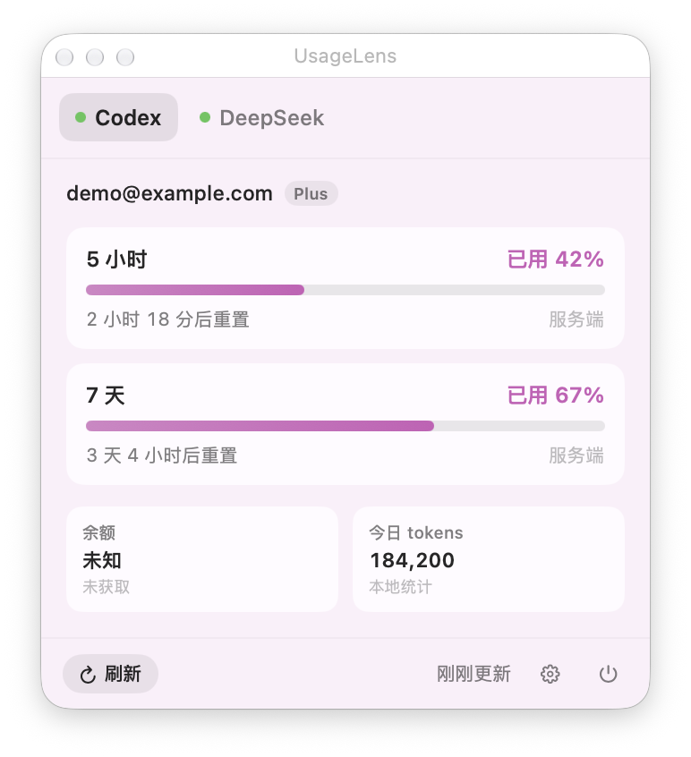
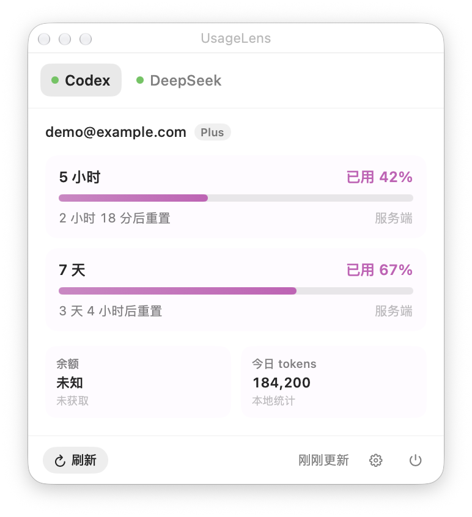
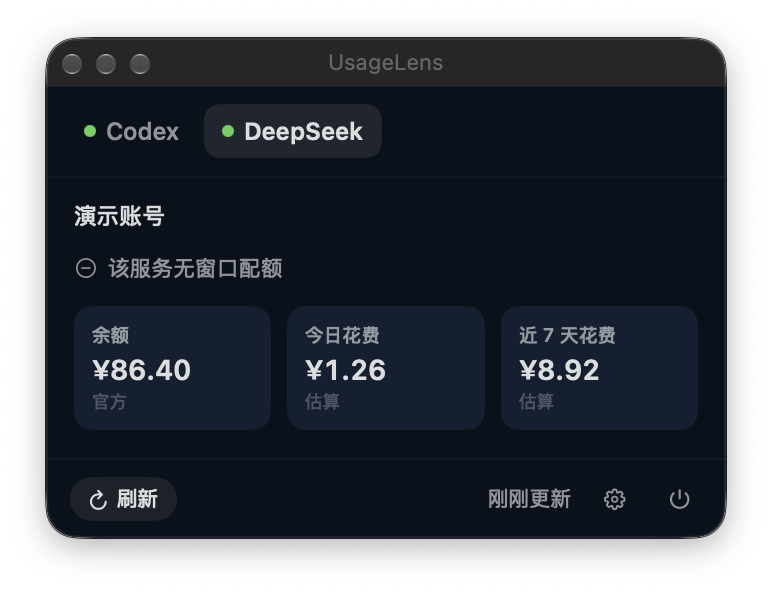

<div align="center">

# UsageLens

**把 AI 编程工具的用量状态，放进 macOS 菜单栏。**

Codex · AGY（Antigravity） · Gemini · OpenCode · DeepSeek · 三种外观主题 · 原生 Swift 探针

</div>

<p align="center">
  
  &nbsp;&nbsp;
  
  &nbsp;&nbsp;
  
</p>

<p align="center"><sub>科技感 · 二次元 · 跟随系统。截图使用演示数据，不包含真实账号或用量。</sub></p>

<p align="center">
  
</p>

<p align="center"><sub>DeepSeek 标签页：余额来自官方接口，今日与近 7 天花费为本地估算。</sub></p>

## 这个项目做什么

UsageLens 是一个原生 Swift / SwiftUI macOS 菜单栏用量看板。它在进程内直接通过原生 Swift 探针读取本机 AI 编程工具的登录态与会话日志，并按需向对应官方接口查询实时配额或余额，把配额窗口、重置倒计时、今日 tokens、余额和花费估算集中展示在一个小面板中。

菜单栏图标是一双会眨眼的眼睛。点击后可以切换已启用的模型厂商、手动刷新数据，也可以通过右下角齿轮按钮打开配置页更换主题、管理显示的厂商、查看各厂商使用说明或开启「登录后启动」。

## 如何使用（首次使用三步）

1. **在终端登录对应工具**：按下方表格在终端完成对应工具的登录或日常使用（AGY 与 Gemini CLI 均通过浏览器 Google 登录自动保存凭据，**通常无需手动寻找或粘贴 OAuth token**）。
2. **启动 UsageLens 并选择对应标签页**：点击屏幕顶部菜单栏的「眼睛」图标，在顶部切换 `Codex`、`AGY`、`Gemini`、`OpenCode` 或 `DeepSeek`。
3. **点击「刷新」**：在面板左下角点「刷新」（AGY 空态可点「重新检测 AGY」）；若首次读取 macOS 登录钥匙串弹出权限框，按需允许即可。

## 当前支持与各厂商登录方式

默认启用 **Codex、AGY、Gemini、OpenCode** 四个标签页，**DeepSeek** 可在配置页按需添加或移除（默认配置以 `ProviderCatalog` 为准，可在「⚙️ 配置 → 模型厂商」中自由调整）。

| 厂商 | 对应工具与登录/凭据方式 | 展示内容与数据口径 |
|---|---|---|
| **Codex** | 在终端运行 `codex` 登录并使用，无需在 UsageLens 手动填 token | 优先查询官方实时 `5 小时 / 7 天` 配额并回退至 `~/.codex/sessions/` 本地会话日志；本地统计 **今日 tokens** |
| **AGY** | 在终端运行 `agy acp --login`（或直接运行 `agy`）完成浏览器 Google 登录；自动读取 macOS 登录钥匙串（`service="gemini", account="antigravity"`），**无需手动复制 OAuth token** | 查询官方 `daily-cloudcode-pa.googleapis.com` 的实时 `5 小时 / 7 天` 配额窗口；本地扫描 `~/.gemini/antigravity-cli/brain/` 与 `~/.gemini/antigravity/brain/` 统计 **今日 tokens** |
| **Gemini** | 推荐在终端运行 `gemini` 并选择浏览器 Google 登录；自动只读复用 `~/.gemini/oauth_creds.json`，**通常无需手动 token**。配置页中的「邮箱 + OAuth Access Token + 可选 Google Cloud Project ID」仅作可选高级手动覆盖（优先级高于本机 CLI，**不要填入 API Key**） | 查询官方 `cloudcode-pa.googleapis.com` 的服务端 `5 小时 / 7 天` 配额窗口（无本地今日 tokens 统计） |
| **OpenCode** | 当前为预留标签，无需在 UsageLens 填写 token（如暂不需要可在配置页移除） | 原生用量探针尚未接入，面板会如实提示暂未接入 |
| **DeepSeek** | 在「⚙️ 配置 → DeepSeek」中验证并保存 API Key（存入 macOS 钥匙串）查询官方余额；也支持开发环境 `DEEPSEEK_API_KEY` | 官方余额接口（`https://api.deepseek.com`）+ 本地记录估算的今日与近 7 天花费（非官方账单） |

> 提示：登录或配置成功不代表服务端一定返回全部配额窗口，也不代表本机必然已有历史会话记录；缺失数据会如实显示「无数据」或「未知」，不会将未知值伪装成 `0`。

## AGY 与 Gemini 的区别

- **AGY** 面向 **Antigravity（`agy` CLI / IDE）**：使用 macOS 登录钥匙串中的 `service="gemini", account="antigravity"` 登录态，查询 `https://daily-cloudcode-pa.googleapis.com`，并统计本地「今日 tokens」。
- **Gemini** 面向 **Google Gemini CLI（`gemini`） / Code Assist**：优先读取配置页手动覆盖账号，否则只读复用 `~/.gemini/oauth_creds.json`，查询 `https://cloudcode-pa.googleapis.com`（部分 Workspace 账号可通过配置页或 `GEMINI_PROJECT_ID` / `GOOGLE_CLOUD_PROJECT` / `GOOGLE_CLOUD_PROJECT_ID` 指定 Google Cloud 项目 ID）。
- 两者凭据存放位置与服务端配额池不同，请不要把 AGY 的凭据填进 Gemini 配置；平时只用 `agy` 的用户直接看 **AGY** 标签页即可，不需要的标签可在配置页点击 `-` 隐藏。

## 升级后找不到 AGY 标签页怎么办

如果你此前已运行过旧版 UsageLens 并保存过自定义的厂商列表，升级到新版后**不会自动覆写或迁移你的已保存列表**，因此顶部标签栏可能暂时只显示旧列表中的厂商。

恢复步骤（无需删除偏好设置或重装）：
1. 点击面板右下角的 **⚙️ 配置** 按钮；
2. 在「模型厂商」下方点击 **「添加模型厂商」 → 「添加 AGY」**；
3. 切回主面板，点击顶部的 **AGY** 标签页并刷新即可。

### 界面主题

- **科技感**：深色底板与青蓝高亮。
- **二次元**：柔和粉紫色调。
- **跟随系统**：采用 macOS 当前的明暗外观与强调色。

## 安装、构建与运行

需要 macOS 14 或更新版本，以及 Swift 5.9+ 工具链。

```bash
git clone https://github.com/zg9uagfv/usage-lens.git
cd usage-lens
./app/Scripts/build-app.sh
open app/dist/UsageLens.app
```

- **原生 Swift 运行时**：UsageLens 在应用进程内直接执行原生 Swift 探针，**日常运行不依赖 Python、不依赖仓库中的 `probes/` 目录，也不需要设置 `USAGE_LENS_ROOT`**；可将构建生成的 `app/dist/UsageLens.app` 直接移到 `/Applications` 或其他目录独立运行。
- 仓库中的 `probes/*.py` 与 `tests/test_*.py` 作为参考实现与隔离兼容测试保留；`app/Scripts/build-app.sh` 当前仍会复制 `probes/*.py` 到 bundle 资源目录，但 App 原生运行时不会启动 `python3` 子进程执行它们。

开发编译与测试（从仓库根目录执行）：

```bash
swift build --package-path app
swift test --package-path app
```

更多 App 侧构建与开发环境变量说明见 [app/README.md](app/README.md)。

## 隐私与数据口径

- **本地数据与官方请求边界**：会话日志仅在本机读取；UsageLens 不提供云同步或第三方遥测。各原生探针仅在具备对应凭据时向对应厂商官方 HTTPS 端点发起认证刷新、配额或余额查询，且严格拒绝跟随 HTTP 3xx 重定向。
- **凭据存储与读写说明**：
  - DeepSeek API Key 与 Gemini 可选手动覆盖账号仅在验证成功后保存至 macOS 登录钥匙串，界面以掩码展示，不回填明文；
  - Gemini CLI（`~/.gemini/oauth_creds.json`）采用只读复用（仅在内存中按需刷新访问令牌，零写盘）；
  - AGY 仅访问精确钥匙串条目 `(service="gemini", account="antigravity")`，当访问令牌过期并通过官方 `https://oauth2.googleapis.com/token` 验证刷新成功时，会以原位原子 `SecItemUpdate` 安全回写更新后的凭据，不枚举钥匙串、不扩大 ACL，也不修改本地 `auth.json`。
- **数据口径**：没有数据时显示「无数据」或「未知」，不伪装成 `0`；刷新失败时在适用情况下保留上次成功值并标明状态；DeepSeek 的本地花费估算会标明来源，不等同于官方账单；OpenCode 当前为预留标签，原生用量探针尚未接入。

## 项目结构

```text
app/Sources/UsageLensKit/ 原生 Swift 探针、契约解析、安全与状态归约
app/Sources/UsageLensUI/  SwiftUI 面板、配置页、关于页与刷新状态
app/Sources/UsageLens/    macOS 菜单栏入口与窗口缩放管理
app/Tests/                Kit、安全/生命周期与 UI 渲染测试
probes/                   Python 参考探针（保留用于对照与隔离测试，非当前 App 运行时）
tests/                    Python 参考探针单元测试
docs/                     需求、架构与接入调研文档
```

## 文档

- [App 构建与开发说明](app/README.md)
- [需求范围](docs/REQUIREMENTS.md)
- [架构与探针契约](docs/ARCHITECTURE.md)
- [Claude 接入评估记录](docs/RESEARCH_claude-usage.md)

## 当前边界

当前内置 5 个厂商：**Codex、AGY、Gemini、OpenCode、DeepSeek**。暂不支持自定义厂商、按模型/项目归因的账单报表或数据导出，也不内置独立的 OAuth 浏览器登录流程（请通过对应 CLI 工具完成登录）。
