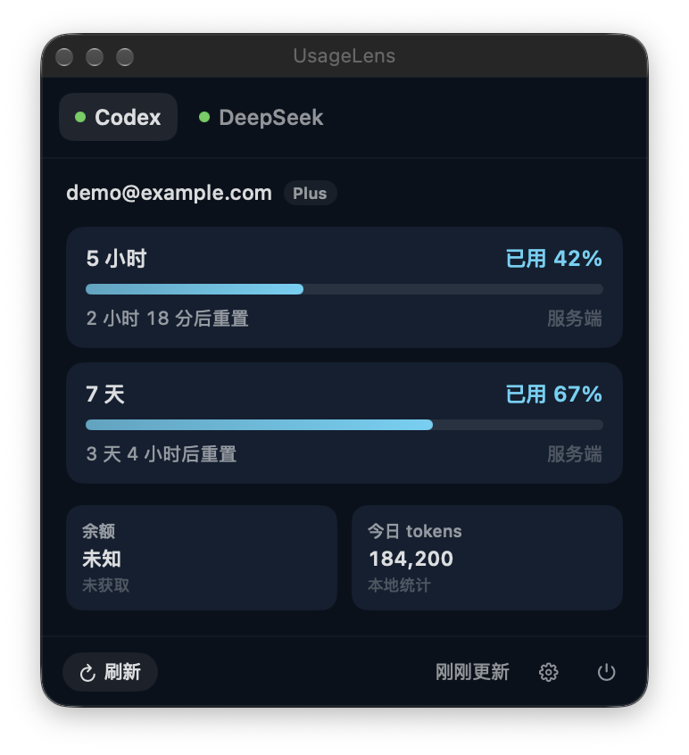

<div align="center">

# UsageLens

**把 AI 编程工具的用量状态，放进 macOS 菜单栏。**

Codex 配额与本地 token 统计 · Gemini 本地用量与花费估算 · DeepSeek 余额与花费估算 · 三种外观主题

</div>

<p align="center">
  
  &nbsp;&nbsp;
  
  &nbsp;&nbsp;
  
</p>

<p align="center"><sub>科技感 · 二次元 · 跟随系统。截图使用演示数据，不包含真实账号或用量。</sub></p>

<p align="center">
  
</p>

<p align="center"><sub>DeepSeek 标签页：余额来自官方接口，今日与近 7 天花费为本地估算。</sub></p>

## 这个项目做什么

UsageLens 是一个纯 Swift / SwiftUI 原生 macOS 菜单栏用量看板。它直接从本机 Codex、Gemini 与 DeepSeek 的日志读取数据，用小面板展示配额窗口、重置时间、余额和用量；零 Python 运行时依赖，也不把本地会话日志上传到 UsageLens 服务。

菜单栏图标是一双会眨眼的眼睛。点击后可以切换已启用的模型厂商、手动刷新数据，也可以打开配置页更换主题、添加或移除厂商、设置登录后启动。

## 当前支持

| 工具 | 显示内容 | 数据来源 |
|---|---|---|
| **Codex** | 5 小时与 7 天配额、重置倒计时、计划类型、今日 tokens | `~/.codex/sessions/` 本地会话日志 |
| **Gemini** | 今日 tokens、今日与近 7 天花费估算 | `~/.gemini/` 本地会话日志（Antigravity / Gemini CLI） |
| **DeepSeek** | 账户余额、今日与近 7 天花费估算 | 官方余额接口 + 本地 DeepSeek 会话记录 |

DeepSeek 余额查询需要 API Key，可在面板的齿轮配置页添加；密钥保存在 macOS 钥匙串，仅在内存内用于官方余额请求。也支持 `DEEPSEEK_API_KEY` 环境变量用于开发。UsageLens 只向 `https://api.deepseek.com` 查询余额；缺少 key 时仍会尝试展示本地花费估算。花费是根据本地 token 记录和公开牌价计算的估值，不等同于官方账单。

### 界面主题

- **科技感**：深色底板与青蓝高亮。
- **二次元**：柔和粉紫色调。
- **跟随系统**：采用 macOS 当前的明暗外观与强调色。

## 安装与运行

需要 macOS 14 或更新版本，以及 Swift 5.9 工具链。

```bash
git clone https://github.com/zg9uagfv/usage-lens.git
cd usage-lens/app
./Scripts/build-app.sh
open dist/UsageLens.app
```

应用为纯 Swift 自包含 `.app`，可直接拖放到 `/Applications` 运行，无需外部脚本或 Python 环境。

开发时也可以通过环境变量提供 DeepSeek API Key：

```bash
export DEEPSEEK_API_KEY="你的 DeepSeek API Key"
open app/dist/UsageLens.app
```

开发时也可以直接编译或运行测试：

```bash
cd app
swift build
swift test
```

## 隐私与数据口径

- Codex 与 DeepSeek 的会话记录只在本机读取；UsageLens 不提供云同步或遥测。
- DeepSeek API Key 保存于 macOS 登录钥匙串，不写入普通配置文件或日志；查询余额时会发送给 DeepSeek 官方 API。应用拒绝跟随重定向。
- 没有数据时显示“无数据”，不会把未知值伪装成 `0`；读取失败会显示原因，并在适用时保留上次成功值。
- DeepSeek 没有窗口配额，因此不绘制百分比进度条；本地花费估算会标明来源。
- 配置页可管理显示的模型厂商（Codex、Gemini、OpenCode、DeepSeek）；Codex、Gemini、OpenCode 默认启用，DeepSeek 可按需添加。

## 项目结构

```text
app/Sources/UsageLensKit/
  Probes/                 纯 Swift 原生探针（Codex / Gemini / DeepSeek）
  ...                     契约模型、状态归约、钥匙串与格式化
app/Sources/UsageLensUI/  SwiftUI 面板、配置页与刷新状态
app/Sources/UsageLens/    macOS 菜单栏入口
app/Tests/                探针、Kit 与界面渲染测试
docs/                     需求、架构与数据来源说明
```

所有探针均以纯 Swift 实现在 `UsageLensKit` 中，输出统一的 `ProbeEnvelope` 契约模型。

## 文档

- [需求范围](docs/REQUIREMENTS.md)
- [架构与探针契约](docs/ARCHITECTURE.md)
- [Claude 接入评估记录](docs/RESEARCH_claude-usage.md)
- [App 构建与开发说明](app/README.md)

## 当前边界

当前内置纯 Swift 探针支持 Codex、Gemini 与 DeepSeek。自定义 provider、按模型 / 项目归因、账单报表与导出尚未实现。欢迎通过 Issue 讨论新的数据源与接入方式。
