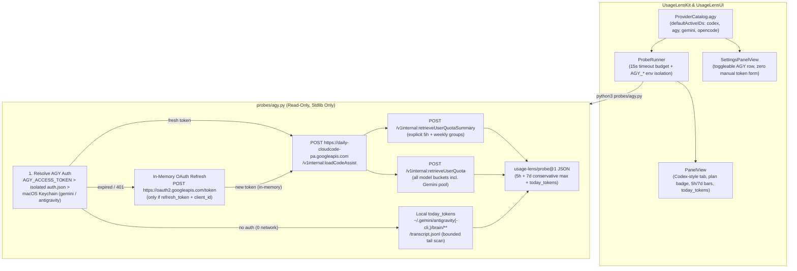

# Technical Design: Codex-Style First-Class AGY (Antigravity) Usage

## 1. Architecture Overview

AGY is integrated as a dedicated, zero-configuration first-class provider (`id: "agy"`, `displayName: "AGY"`, `probes/agy.py`) mirroring `probes/codex.py`, while leaving `probes/gemini.py` intact for Gemini CLI / manual Gemini accounts.



---

## 2. Empirical Research Findings (AGY on macOS)

Read-only schema inspection of the local macOS AGY installation revealed the exact mechanisms AGY uses:

1. **Local Auth Storage (`go-keyring` in macOS Login Keychain)**:
   - Keychain item attributes: `service = "gemini"`, `account = "antigravity"`.
   - Raw secret value is encoded with `zalando/go-keyring`'s base64 wrapper: `"go-keyring-base64:"` + standard Base64 of UTF-8 JSON.
   - Decoded JSON schema (keys and types only):
     ```json
     {
       "token": {
         "access_token": "string",
         "token_type": "string",
         "refresh_token": "string",
         "expiry": "string (RFC3339 with timezone offset)",
         "expires_in": "int"
       },
       "auth_method": "string",
       "id_token_email": "string",
       "writer_id": "string"
     }
     ```
   - **Important architectural decision**: Reading this Keychain item via `/usr/bin/security find-generic-password -s gemini -a antigravity -w` inside `probes/agy.py` succeeds read-only with zero GUI prompts, whereas calling `SecItemCopyMatching` directly from an ad-hoc signed `UsageLens.app` Swift process would trigger macOS Keychain ACL dialogs. Therefore, Keychain access stays strictly inside `probes/agy.py`.

2. **Official AGY Live Quota Endpoints (`daily-cloudcode-pa.googleapis.com`)**:
   - AGY CLI logs confirm AGY talks to **`https://daily-cloudcode-pa.googleapis.com`** (NOT `cloudcode-pa.googleapis.com`, which returns `remainingFraction: 1` for AGY's Gemini models and does not reflect AGY's live pool consumption).
   - **`POST https://daily-cloudcode-pa.googleapis.com/v1internal:loadCodeAssist`**:
     - Request body: `{"metadata": {"ideType": "IDE_UNSPECIFIED", "platform": "PLATFORM_UNSPECIFIED", "pluginType": "GEMINI"}}` (note: `ideType: "ANTIGRAVITY"` returns HTTP 400; `IDE_UNSPECIFIED` returns HTTP 200).
     - Response keys: `cloudaicompanionProject` (`string`), `currentTier` (`{"id": "string", "name": "string"}`), `paidTier` (`{"id": "string", "name": "string"}`).
   - **`POST https://daily-cloudcode-pa.googleapis.com/v1internal:retrieveUserQuotaSummary`**:
     - Request body: `{"project": "<cloudaicompanionProject>"}` (or `{}` if absent).
     - Response schema:
       ```json
       {
         "description": "string",
         "groups": [
           {
             "displayName": "string",
             "description": "string",
             "buckets": [
               {
                 "bucketId": "string",
                 "displayName": "string",
                 "window": "5h | weekly",
                 "remainingFraction": 1.0,
                 "resetTime": "2026-11-28T04:35:48Z"
               }
             ]
           }
         ]
       }
       ```
     - Provides explicit `5h` and `weekly` (`7d`) buckets for model groups (e.g. Claude & GPT models).
   - **`POST https://daily-cloudcode-pa.googleapis.com/v1internal:retrieveUserQuota`**:
     - Request body: `{"project": "<cloudaicompanionProject>"}` (or `{}` if absent).
     - Response schema: `{"buckets": [{"modelId": "string", "tokenType": "WTUS", "remainingFraction": 0.41, "resetTime": "2026-11-21T05:16:03Z"}, ...]}`.
     - Includes all active AGY model pools (including Gemini models whose live consumption is not always duplicated in `retrieveUserQuotaSummary`).

3. **Local AGY Transcript Token Usage (`today_tokens`)**:
   - Stored in `~/.gemini/antigravity-cli/brain/*/.system_generated/logs/transcript.jsonl` and `~/.gemini/antigravity/brain/*/.system_generated/logs/transcript.jsonl`.
   - Relevant JSONL fields on `PLANNER_RESPONSE` records:
     - `created_at`: UTC ISO8601 string (e.g. `"2026-11-21T04:28:44Z"`)
     - `input_tokens`: non-cached input tokens (`int`)
     - `output_tokens`: output tokens (`int`)
     - `cache_read_tokens`: cached input tokens (`int`, observed independently of `input_tokens`)

---

## 3. Probe Design (`probes/agy.py`)

Stdlib-only Python 3.9+ script (`chmod +x`), outputting a single strict `usage-lens/probe@1` JSON line (`allow_nan=False`).

### 3.1 Constants & Network Security
- `SCHEMA = "usage-lens/probe@1"`, `PROVIDER = "agy"`
- `OFFICIAL_SCHEME = "https"`
- `OFFICIAL_HOST = "daily-cloudcode-pa.googleapis.com"`
- `LOAD_CODE_ASSIST_URL = "https://daily-cloudcode-pa.googleapis.com/v1internal:loadCodeAssist"`
- `RETRIEVE_QUOTA_SUMMARY_URL = "https://daily-cloudcode-pa.googleapis.com/v1internal:retrieveUserQuotaSummary"`
- `RETRIEVE_QUOTA_URL = "https://daily-cloudcode-pa.googleapis.com/v1internal:retrieveUserQuota"`
- `OAUTH_TOKEN_HOST = "oauth2.googleapis.com"`
- `OAUTH_TOKEN_URL = "https://oauth2.googleapis.com/token"`
- `HTTP_TIMEOUT_SECONDS = 3.0`, `HTTP_MAX_BYTES = 1024 * 1024` (1 MB)
- `KEYCHAIN_TIMEOUT_SECONDS = 2.0`, `KEYCHAIN_SERVICE = "gemini"`, `KEYCHAIN_ACCOUNT = "antigravity"`
- `_RejectRedirect(urllib.request.HTTPRedirectHandler)` returning `None` for all 3xx; module-level `_OPENER = urllib.request.build_opener(_RejectRedirect())` (patchable in tests).
- `is_official_url(url)` / `is_official_oauth_url(url)`: strictly `https`, exact pinned host, port `None` or `443`.
- `redact(text)`: identical comprehensive pattern set as `probes/gemini.py` (`eyJ...`, `ya29.*`, `1//*`, `Bearer *`, `sk-*`, `key/token/secret/password = ...`, opaque `>=32`-char strings).

### 3.2 Credential Resolution (`_resolve_credentials`)
Priority order (strictly read-only):
1. **Manual / test env override**: `AGY_ACCESS_TOKEN` (optional `AGY_ACCOUNT_EMAIL`, `AGY_PROJECT_ID`). If set, returns `source="manual"` without reading Keychain or local files.
2. **Disable gate**: If `AGY_DISABLE_LOCAL_AUTH == "1"`, returns `None` (zero Keychain, zero network).
3. **Optional local auth file** (`AGY_AUTH_FILE` env var, or `$HOME/.gemini/antigravity-cli/auth.json` if present — supports deterministic subprocess tests with isolated `HOME` and `go-keyring-base64:` or raw JSON).
4. **macOS Keychain (only when `HOME` is not isolated)**:
   - Guard: compare `os.path.realpath(str(Path.home())) == os.path.realpath(pwd.getpwuid(os.getuid()).pw_dir)` (and `sys.platform == "darwin"`). When a test overrides `HOME` to a temp directory, this guard automatically skips the real macOS login Keychain!
   - Invokes `subprocess.run(["/usr/bin/security", "find-generic-password", "-s", KEYCHAIN_SERVICE, "-a", KEYCHAIN_ACCOUNT, "-w"], capture_output=True, text=True, timeout=KEYCHAIN_TIMEOUT_SECONDS, check=False)`.
   - Decodes payload via `_decode_keyring_payload(raw)`:
     - Strips `"go-keyring-base64:"` prefix if present and base64-decodes UTF-8 JSON; otherwise attempts direct JSON parse.
     - Extracts `token.access_token`, `token.refresh_token`, `token.expiry` (RFC3339 via `parse_iso_epoch`), `id_token_email`, optional `client_id`/`client_secret` (falling back to `AGY_OAUTH_CLIENT_ID`/`AGY_OAUTH_CLIENT_SECRET`).
5. If none yields an `access_token` or `refresh_token`, returns `None` → zero-network gate.

### 3.3 In-Memory Token Refresh (`_refresh_access_token`)
- Triggered only for `source == "local"` when:
  - Proactive: `access_token` is empty OR (`expiry_epoch is not None` and `expiry_epoch <= now.timestamp() + 60.0`)
  - Reactive (at most once via `refreshed_once = False`): `loadCodeAssist`, `retrieveUserQuotaSummary`, or `retrieveUserQuota` returns HTTP `401`.
- Requires non-empty `refresh_token` and `client_id`. If unavailable, returns `(None, "本机 AGY 登录态已过期，请先运行 agy 刷新登录态")`.
- Sends `POST https://oauth2.googleapis.com/token` with `_OPENER`, `3.0s` timeout, `1 MB` cap, host check; keeps refreshed `access_token` strictly in memory (zero writes to Keychain/disk).

### 3.4 Quota Query & Window Normalization
1. **Project & Plan Discovery (`loadCodeAssist`)**:
   - Skipped only if `AGY_PROJECT_ID` was explicitly supplied.
   - Extracts `project_id = load_data.get("cloudaicompanionProject")` and `plan = _extract_plan(load_data)` (prefers `paidTier.name` → `paidTier.id` → `currentTier.name` → `currentTier.id`).
2. **Quota Collection (Summary + Model Buckets)**:
   - Calls `POST /v1internal:retrieveUserQuotaSummary` (`{"project": project_id}` or `{}`).
   - Calls `POST /v1internal:retrieveUserQuota` (`{"project": project_id}` or `{}`).
   - Collects all candidate buckets from `summary["groups"][*]["buckets"]` AND `quota["buckets"]`.
   - If one endpoint fails while the other succeeds, proceeds with the available buckets and records a non-fatal Chinese warning; if both fail, triggers the failure/fallback path.
3. **Window Classification (`_classify_window`)**:
   - Explicit `window` / `bucketId` / `windowDuration` / `quotaDuration` first:
     - `"5h"`, `"five_hour"`, `"5 小时"`, or duration in `[14400, 21600]`s → `"5h"`
     - `"weekly"`, `"7d"`, `"7 天"`, or duration in `[518400, 691200]`s → `"7d"`
   - Fallback by `resetTime` delta (`reset_epoch - now_epoch`):
     - `<= 24 * 3600` → `"5h"`
     - `> 24 * 3600` → `"7d"`
   - Buckets with neither explicit window nor `resetTime` are ignored (never guessed).
4. **Conservative Aggregation (`_normalize_buckets`)**:
   - Converts `remainingFraction` (`0.0 <= rem <= 1.0`, finite, non-bool) → `used_percent = round((1.0 - rem) * 100.0, 2)`. Out-of-range/non-finite → `None` + Chinese warning.
   - For each window (`"5h"`, `"7d"`), picks the bucket with the **highest `used_percent`** (tie-breaking on earliest `resetTime`); if all `used_percent` are `None`, picks earliest `resetTime`.
   - Marks `expired = (resets_epoch is not None and resets_epoch < now_epoch)` with warning `"%s窗口已于 %s重置"`.
   - Emits `basis: "server"`, `window_seconds: 18000` (`5h`) or `604800` (`7d`).

### 3.5 Local `today_tokens` Scanner (`find_today_tokens`)
- Scans `Path.home() / ".gemini" / "antigravity-cli" / "brain"` and `Path.home() / ".gemini" / "antigravity" / "brain"` (patchable `BRAIN_DIRS` for tests).
- Finds `*/.system_generated/logs/transcript.jsonl`, sorts by `mtime` descending, caps at `TODAY_TOKEN_SCAN_FILES = 50`.
- Stops scanning older files once `date.fromtimestamp(mtime) < today`.
- Reads each file from the tail in `256 KB` chunks up to `MAX_SCAN_BYTES = 4 MB` (reusing the exact reverse-tail pattern from `probes/codex.py`).
- For each JSON line where `created_at` local date == `today`, sums finite non-negative `input_tokens + output_tokens + cache_read_tokens` (skipping `bool`).
- Returns `(total if found else None, warnings)`.

### 3.6 Fallback & Exit Code Matrix
| State | Exit Code | `windows` | `usage` | `error` | `warnings` |
|---|---|---|---|---|---|
| Live succeeded | `0` | `[5h, 7d]` | `today_tokens` or `null` | `null` | partial/truncation/expired warnings if any |
| Unauthenticated / isolated `HOME` (0 network) | `0` | `[]` | `today_tokens` or `null` | `null` | `["未检测到本机 AGY 登录态，请先运行 agy 登录以查看 5 小时与 7 天用量"]` |
| Live failed + local `today_tokens` available | `0` | `[]` | `{"today_tokens": N, "source": "local"}` | `null` | `["实时查询 AGY 服务端失败（<reason>），当前仅显示本地今日 tokens"]` |
| Live failed + no local `today_tokens` | `1` | `[]` | `null` | `"查询 AGY 用量失败：<reason>"` | `[]` |

---

## 4. Swift Core Library & UI Integration

### 4.1 `app/Sources/UsageLensKit/Provider.swift`
- Add `ProviderCatalog.agy`:
  ```swift
  public static let agy = Provider(
      id: "agy",
      displayName: "AGY",
      probeRelativePath: "probes/agy.py"
  )
  ```
- Update `ProviderCatalog.available`:
  `[codex, agy, gemini, opencode, deepseek]`
- Update `ProviderCatalog.defaultActiveIDs`:
  `["codex", "agy", "gemini", "opencode"]`

### 4.2 `app/Sources/UsageLensKit/ProbeRunner.swift`
- Add `ProviderCatalog.agy.id: 15` to `defaultProviderTimeouts` (bounded budget for Keychain lookup + up to 4 sequential `3.0s` HTTPS calls).
- In `execute(...)`, enforce env isolation:
  - When `provider?.id != ProviderCatalog.agy.id`, remove `AGY_ACCESS_TOKEN`, `AGY_ACCOUNT_EMAIL`, `AGY_PROJECT_ID`, `AGY_AUTH_FILE`, `AGY_DISABLE_LOCAL_AUTH`, `AGY_OAUTH_CLIENT_ID`, `AGY_OAUTH_CLIENT_SECRET` from subprocess environment.
  - Existing `DEEPSEEK_API_KEY` and `GEMINI_*` removal automatically protects `agy` from receiving other providers' secrets.

### 4.3 `app/Sources/UsageLensUI/PanelView.swift` & `SettingsPanelView.swift`
- **`PanelView.swift`**:
  - Already renders any provider with `windows` + `account.label` + `account.plan` + `usage.todayTokens` + `warnings` in the exact Codex style!
  - Verify tab bar width with 4 default tabs (`Codex`, `AGY`, `Gemini`, `OpenCode`) across all 4 `DisplayScaleMetrics` presets (`compact`, `standard`, `comfortable`, `large`) — `AGY` is only 3 characters, fitting comfortably inside `panelWidth` without wrapping or clipping.
- **`SettingsPanelView.swift`**:
  - `AGY` automatically appears in `"模型厂商"` right after `Codex` with `building.2.crop.circle` and a `minus.circle` remove button (and re-appears in `"添加模型厂商"` when removed), matching Codex's zero-config UX with zero manual token entry required.

---

## 5. Verification & Deterministic Test Strategy

### 5.1 Python Probe Tests (`tests/test_agy.py`)
All tests run offline with zero real Keychain or internet access:
1. **Zero-network isolated `HOME` gate**: empty isolated `HOME` → 0 network calls, exit `0`, `windows == []`, Chinese login guidance warning, `support.fingerprint(home)` unchanged.
2. **`AGY_DISABLE_LOCAL_AUTH=1`**: ignores local `auth.json` → 0 network calls, exit `0`, guidance warning.
3. **`go-keyring-base64:` decoding & live 200 success**: synthetic `auth.json` with `go-keyring-base64:` payload + mocked `_OPENER` returning `loadCodeAssist` (`paidTier: Google AI Pro`), `retrieveUserQuotaSummary` (`3p-5h: 1.0`, `3p-weekly: 0.85`), and `retrieveUserQuota` (`gemini-2.5-pro: 0.41` resetting in 2h) → verifies conservative max picks `5h = 59.0%` (from Gemini bucket) and `7d = 15.0%` (from weekly summary bucket), `account.label`, `account.plan == "Google AI Pro"`, `observed_at == generated_at`, `stale == False`, `basis == "server"`.
4. **Local `today_tokens` aggregation**: synthetic `transcript.jsonl` under both `antigravity-cli/brain` and `antigravity/brain` with today + yesterday entries, `input_tokens + output_tokens + cache_read_tokens`, corrupt lines, and `>4MB` truncation warning.
5. **In-memory OAuth refresh (proactive + reactive 401)**: verifies `POST https://oauth2.googleapis.com/token`, single retry (`refreshed_once`), and zero disk writes (`support.fingerprint(home)` unchanged).
6. **Expired auth without `client_id`**: with local `today_tokens` → exit `0`, `usage` preserved + warning; without local `today_tokens` → exit `1`, redacted Chinese `error`.
7. **Partial endpoint resilience & malformed values**: summary 500 + quota 200 (still returns `5h` + warning); NaN / `remainingFraction > 1.0` / `< 0.0` → `used_percent: None` + warning, strict JSON (`allow_nan=False`).
8. **Security redlines**:
   - `is_official_url` / `is_official_oauth_url` host/scheme/port/userinfo pinning tests.
   - `LocalPostServer` HTTP 302 redirect test → redirect target receives **zero** requests (no `Authorization` or `refresh_token` leak).
   - Oversized response (`> 1 MB`) rejected.
   - Synthetic `ya29.*`, `1//*`, `eyJ...`, `Bearer`, `sk-*` tokens never appear in stdout or stderr.

### 5.2 Swift Tests (`app/Tests/UsageLensKitTests/` & `app/Tests/UsageLensUITests/`)
1. **`UsageLensKitTests`**:
   - Verify `ProviderCatalog.agy` metadata (`id == "agy"`, `displayName == "AGY"`, `probeRelativePath == "probes/agy.py"`, `!requiresCredentials`), presence in `available` and `defaultActiveIDs`.
   - Verify `ProbeRunner.effectiveTimeout(for: .agy) == 15` and env isolation (`AGY_*` not leaked to other providers; `GEMINI_*` / `DEEPSEEK_API_KEY` not leaked to `agy`).
2. **`UsageLensUITests`**:
   - Hosted AppKit / SwiftUI `ImageRenderer` snapshot tests for `PanelView` with `AGY` selected (live `5h`/`7d` windows + `Google AI Pro` plan badge + `today_tokens` tile) and `SettingsPanelView` listing `Codex` + `AGY` + `Gemini` + `OpenCode` across `DisplayScaleMetrics` presets (`compact`, `standard`, `large`) and all 3 themes (`system`, `light`, `dark`), verifying non-empty renders and zero layout clipping.
