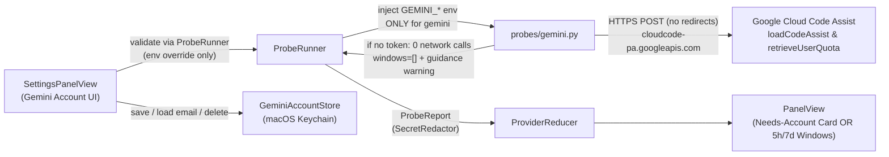

# Technical Design: Gemini Account-Gated 5-Hour & 7-Day Usage Windows

## 1. Architecture Overview

`UsageLens` follows a strict split:
- **Python CLI Probes (`probes/<id>.py`)**: Self-contained Python 3.9+ stdlib-only scripts outputting a single `usage-lens/probe@1` JSON line to stdout.
- **Core Library (`app/Sources/UsageLensKit/`)**: Provider catalog, Keychain credential stores, `ProbeRunner` subprocess execution, `ProbeContract` decoding, `ProviderState`/`ProviderReducer`, `SecretRedactor`, and `UsageFormat`.
- **SwiftUI Layer (`app/Sources/UsageLensUI/`)**: `UsageStore`, `PanelView`, `SettingsPanelView`, `Theme`, `DisplayScaling`.

This change extends the existing `DeepSeekAPIKeyStore` + `probes/deepseek.py` + `probes/codex.py` patterns to add full account-gated Gemini 5-hour & 7-day usage support without breaking any existing contracts or providers.



---

## 2. Python Probe Design (`probes/gemini.py`)

### 2.1 CLI & Contract Compliance
- Accepts no arguments or `--json` (any other argument exits `2` with JSON `error`).
- Reads nothing from stdin; writes zero files to disk.
- Outputs exactly one strict JSON line (`json.dumps(..., ensure_ascii=False, allow_nan=False)`) conforming to `usage-lens/probe@1`.
- Stdlib-only (`datetime`, `json`, `math`, `os`, `re`, `sys`, `time`, `urllib.parse`, `urllib.request`, `urllib.error`), compatible with Python 3.9+.

### 2.2 Environment Variables (Injected by `ProbeRunner` or Dev Shell)
- `GEMINI_ACCOUNT_EMAIL`: User-provided Gemini account identifier (e.g. `user@gmail.com`). Populates `account.label`.
- `GEMINI_ACCESS_TOKEN`: Google OAuth access token (`Authorization: Bearer <token>`). Required to query Google's quota API.
- `GEMINI_PROJECT_ID` (optional): Explicit Cloud AI Companion project ID; when omitted, discovered automatically via `loadCodeAssist`.

### 2.3 Account-Gate Logic (Zero Network When Unconfigured)
1. Read and trim `GEMINI_ACCOUNT_EMAIL` and `GEMINI_ACCESS_TOKEN`.
2. If `GEMINI_ACCESS_TOKEN` is missing or empty:
   - Make **zero** HTTP requests.
   - Return exit `0` with:
     ```json
     {
       "schema": "usage-lens/probe@1",
       "provider": "gemini",
       "account": { "label": null, "plan": null },
       "generated_at": "...",
       "observed_at": "...",
       "stale": false,
       "windows": [],
       "balance": null,
       "spend": null,
       "usage": null,
       "coverage": null,
       "warnings": ["请先在配置中提供 Gemini 账号以查看 5 小时与 7 天用量"],
       "error": null
     }
     ```
   - (If `GEMINI_ACCOUNT_EMAIL` is set without `GEMINI_ACCESS_TOKEN`, keep `account.label` as `null` or the email, still make zero network calls, and emit the account-required warning so the UI prompts for complete credentials.)

### 2.4 Official Endpoints & Network Security
- Allowed host/scheme: **strictly** `https://cloudcode-pa.googleapis.com` (port `None` or `443`).
  - `LOAD_CODE_ASSIST_URL = "https://cloudcode-pa.googleapis.com/v1internal:loadCodeAssist"`
  - `RETRIEVE_QUOTA_URL = "https://cloudcode-pa.googleapis.com/v1internal:retrieveUserQuota"`
- Timeout: `HTTP_TIMEOUT_SECONDS = 3.0` per request (well within `ProbeRunner`'s `6s` total timeout).
- Response size cap: `HTTP_MAX_BYTES = 1024 * 1024` (1 MB).
- Redirect policy: `_RejectRedirect(urllib.request.HTTPRedirectHandler)` returning `None` on every 3xx, plus `is_official_url(response.geturl())` verification.
- Request flow when `GEMINI_ACCESS_TOKEN` is present:
  1. If `GEMINI_PROJECT_ID` is not set, `POST loadCodeAssist` with body `{"metadata": {"ideType": "GEMINI_CLI", "platform": "MACOS"}}`:
     - Extract `project_id = data.get("cloudaicompanionProject")` (if string) and `plan = currentTier.id` or `currentTier.name` (if dict/string).
     - If `loadCodeAssist` returns HTTP 401/403 or redirect/network error, abort immediately and return that error (do not proceed to `retrieveUserQuota`).
     - If `loadCodeAssist` succeeds without a project ID, proceed to `retrieveUserQuota` with `{}`.
  2. `POST retrieveUserQuota` with body `{"project": project_id}` (if `project_id` non-empty) else `{}`:
     - Parse JSON response `buckets` (list of bucket dicts).

### 2.5 Mapping Quota Buckets to `5h` and `7d` Windows
Canonical window specs (identical to `probes/codex.py` for UI consistency):
```python
WINDOW_SPEC = {
    "5h": {"id": "5h", "label": "5 小时", "window_seconds": 18000},
    "7d": {"id": "7d", "label": "7 天", "window_seconds": 604800},
}
```

Bucket classification (`_classify_window(bucket, now)`):
1. **Explicit duration / window field** (check `windowDuration`, `quotaDuration`, `duration`, `period`, `windowSeconds`, `window_seconds`, `window`, `id`):
   - Parse ISO-8601 duration (`PT5H`, `P7D`), suffixed strings (`18000s`, `5h`, `300m`, `604800s`, `7d`, `168h`), or numeric seconds:
     - `14400 <= seconds <= 21600` (5h ± 1h) → `"5h"`
     - `518400 <= seconds <= 691200` (7d ± 1d) → `"7d"`
2. **Fallback via `resetTime` delta** (when the API omits explicit duration metadata, as observed in `cloudcode-pa` responses):
   - Parse `resetTime` (ISO-8601 UTC string) → `delta = resets_epoch - now_epoch`.
   - If `delta <= 24 * 3600` (short rolling / 5-hour / sub-day cycle) → `"5h"`.
   - If `delta > 24 * 3600` (multi-day / weekly 7-day cycle) → `"7d"`.
3. **Used percentage calculation** (`_used_percent_from_bucket(bucket, label, warnings)`):
   - Support `remainingFraction` (`0.0..1.0` → `used_percent = round((1.0 - remaining) * 100.0, 2)`) or direct `usedPercent` / `used_percent` (`0.0..100.0`).
   - Validate finite and within bounds (`0.0 <= remainingFraction <= 1.0`, `0.0 <= used_percent <= 100.0`); out-of-range or NaN → `None` + warning (never clamp to fake numbers).
4. **Multi-bucket aggregation per window (`5h`, `7d`)**:
   - Multiple model buckets (e.g., `gemini-2.5-pro`, `gemini-2.5-flash`) may fall into the same window.
   - Select the bucket with the **highest valid `used_percent`** (most constrained quota); break ties by earliest `resets_at`. If all buckets in that window have `used_percent: null`, emit the window with `used_percent: null`.
5. **Output ordering & missing-window honesty**:
   - Emit windows in canonical order `["5h", "7d"]` for those present.
   - If only one of `5h` or `7d` is present, append a warning naming the missing window (e.g., `"Gemini 接口未返回 7 天配额窗口"`).
   - If `buckets` is empty or yields no windows, emit `windows: []` + warning `"Gemini 接口未返回 5 小时或 7 天配额窗口"`.
6. **Secret redaction in `probes/gemini.py`**:
   - Redact `ya29\.[A-Za-z0-9._\-]+`, `1//[A-Za-z0-9._\-]+`, `Bearer\s+\S+`, `sk-[A-Za-z0-9_\-]{5,}`, and opaque tokens `>= 32` chars from all warnings, errors, and stderr logs.

---

## 3. Swift Core Library Design (`app/Sources/UsageLensKit/`)

### 3.1 `Provider.swift`
Extend `Provider` cleanly while preserving full source compatibility with `requiresAPIKey`:
```swift
public struct Provider: Identifiable, Hashable, Sendable {
    public let id: String
    public let displayName: String
    public let probeRelativePath: String
    public let requiresAPIKey: Bool
    public let requiresAccount: Bool

    public init(
        id: String,
        displayName: String,
        probeRelativePath: String,
        requiresAPIKey: Bool = false,
        requiresAccount: Bool = false
    ) { ... }

    public var requiresCredentials: Bool {
        requiresAPIKey || requiresAccount
    }
}
```
Update `ProviderCatalog.gemini`:
```swift
public static let gemini = Provider(
    id: "gemini",
    displayName: "Gemini",
    probeRelativePath: "probes/gemini.py",
    requiresAccount: true
)
```

### 3.2 `GeminiAccountStore.swift` (New File)
Model a small, immutable `GeminiAccount` value and Keychain store mirroring `DeepSeekAPIKeyStore.swift`, with a testable `KeychainStorage` protocol:

```swift
public struct GeminiAccount: Sendable, Equatable {
    public let email: String
    public let accessToken: String
    public let projectID: String?
}
```

- **Keychain coordinates**:
  - `service = "dev.usage-lens.gemini"`
  - `account = "oauth-account"` (stores a JSON-encoded payload `{"email": "...", "access_token": "...", "project_id": "..."}` as UTF-8 `Data` with `kSecAttrAccessibleWhenUnlockedThisDeviceOnly`, so email + token + optional project ID are written, updated, and deleted **atomically** in a single Keychain item!).
- **API**:
  - `hasSavedAccount: Bool`
  - `savedAccountEmail() -> String?` (returns only the non-secret email label for Settings UI; never exposes `accessToken`)
  - `load() -> GeminiAccount?` (internal/public only for `ProbeRunner`; callers must never log `accessToken`)
  - `save(email: String, accessToken: String, projectID: String? = nil) throws` (trims whitespace; throws `.emptyEmail` / `.emptyAccessToken` / `.keychain(OSStatus)`)
  - `delete() throws`
  - `validationMessage(email: String, accessToken: String, projectID: String? = nil, runner: ProbeRunner = ProbeRunner()) async -> String?`:
    - Trims inputs; returns `"Gemini 账号邮箱不能为空"` / `"访问令牌不能为空"` if empty.
    - Runs `runner.report(for: ProviderCatalog.gemini, environmentOverrides: ...)` with `GEMINI_ACCOUNT_EMAIL`, `GEMINI_ACCESS_TOKEN`, and optional `GEMINI_PROJECT_ID`.
    - Succeeds (`nil`) when `report.failure == nil`, `!report.isMissingProbe`, `!report.isIncompatibleSchema`, and `report.envelope` is non-nil (and either `!envelope.windows.isEmpty` or `envelope.account?.label != nil` without an account-required warning).
    - Otherwise returns `report.failure ?? report.warnings.first ?? "Gemini 账号验证失败，请检查后重试"`.
- **Testability**:
  - Internal `GeminiKeychainStorage` protocol (`loadData()`, `saveData(_:)`, `deleteData()`) with `SystemGeminiKeychainStorage` default and `InMemoryGeminiKeychainStorage` for unit tests so `swift test` never touches the real macOS Keychain.

### 3.3 `ProbeRunner.swift`
In `ProbeRunner.execute(...)` (lines 264–272):
- Keep DeepSeek injection restricted to `ProviderCatalog.deepseek.id`.
- Add Gemini injection restricted **strictly** to `ProviderCatalog.gemini.id`:
  ```swift
  if provider?.id == ProviderCatalog.gemini.id,
     let account = GeminiAccountStore.load() {
      environment["GEMINI_ACCOUNT_EMAIL"] = account.email
      environment["GEMINI_ACCESS_TOKEN"] = account.accessToken
      if let projectID = account.projectID, !projectID.isEmpty {
          environment["GEMINI_PROJECT_ID"] = projectID
      }
  }
  ```
- `environmentOverrides` still applies last so pre-save validation overrides Keychain without touching Keychain.
- Ensure `GEMINI_ACCESS_TOKEN` / `GEMINI_ACCOUNT_EMAIL` are never injected into non-Gemini probes (and if `ProbeRunner` is constructed with custom credential loaders for tests, inject via optional closures defaulting to `DeepSeekAPIKeyStore.load` / `GeminiAccountStore.load`).

### 3.4 `SecretRedactor.swift`
Add explicit Google OAuth token patterns before the generic 32-char fallback:
- `#"ya29\.[A-Za-z0-9._-]+"#` → `"***"`
- #"1//[A-Za-z0-9._-]{16,}"# → `"***"`

---

## 4. SwiftUI Layer Design (`app/Sources/UsageLensUI/`)

### 4.1 `PanelView.swift`
1. Pass `showSettings: () -> Void` from `PanelView` into `ProviderDetailView(state: store.state(for: store.selected), showSettings: showSettings)`.
2. Detect the Gemini account-required state in `ProviderDetailView`:
   ```swift
   private var needsAccountConfiguration: Bool {
       state.provider.requiresAccount
           && state.hasLoaded
           && !state.isMissingProbe
           && !state.isIncompatibleSchema
           && state.failureReason == nil
           && state.windows.isEmpty
           && !hasMetrics
           && state.accountLabel == nil
   }
   ```
3. Update `emptyTile` when `needsAccountConfiguration` is `true`:
   - Icon: `person.crop.circle.badge.exclamationmark`
   - Title: `"需要提供 \(state.provider.displayName) 账号"`
   - Reason: `"请在配置中提供 \(state.provider.displayName) 账号，以查看 5 小时与 7 天使用量"`
   - Action button: `"前往配置"` calling `showSettings()`, styled as a compact pill/bordered button scaled via `DisplayScaleMetrics`.
4. Avoid duplicate redundant warnings: when `needsAccountConfiguration` is `true` and the only warning is the standard account-required prompt, the empty card already communicates the prompt clearly (or keep warnings cleanly readable without overlapping).

### 4.2 `SettingsPanelView.swift`
1. Generalize `expandedKeyProviderID` → `expandedCredentialProviderID` so both DeepSeek (`requiresAPIKey`) and Gemini (`requiresAccount`) expand cleanly in the `"模型厂商"` section.
2. Row indicator for Gemini:
   - Icon: `person.crop.circle.badge.checkmark` (when `savedGeminiAccountEmail != nil`) or `person.crop.circle` (when unconfigured).
   - Accessibility label: `"配置 \(provider.displayName) 账号"`.
3. Add `geminiAccountSettings(for provider: Provider)`:
   - **When saved** (`let email = savedGeminiAccountEmail`):
     - Displays saved account email in a disabled/read-only row (`"账号：\(email)"` or read-only `TextField`), masked token field `"****************"` (never plaintext), and destructive `"删除"` button.
   - **When unconfigured**:
     - `TextField("Gemini 账号邮箱（例如 user@gmail.com）", text: $geminiEmailDraft)`
     - `SecureField("粘贴 Gemini 访问令牌 (OAuth Access Token)", text: $geminiTokenDraft)`
     - `Button(isVerifyingGeminiAccount ? "正在验证…" : "验证并保存", action: saveGeminiAccount)` disabled when email or token is blank or verifying.
     - Helper caption explaining Keychain storage and 5h/7d usage retrieval.
   - Status banner (`geminiAccountStatus`) in orange on failure, green on success/delete.
4. Keep `SettingsPanelView.init` backward-compatible with default parameters:
   ```swift
   public init(
       launchAtLogin: LaunchAtLoginManager,
       hasSavedAPIKey: Bool? = nil,
       savedGeminiAccountEmail: String? = nil,
       onAPIKeyChange: @escaping () -> Void = {}
   )
   ```
   (Using an explicit enum or `Bool?` + `String?` override so tests can force unconfigured `nil` without reading the host Keychain.)
5. All new controls use `@Environment(\.displayScaleMetrics)` (`metrics.font(...)`, `metrics.scaledSpacing(...)`) and work cleanly inside `SettingsPanelView`'s `ScrollView` across all display scales and themes.

---

## 5. Verification & Deterministic Test Strategy

### 5.1 Python Probe Tests (`tests/test_gemini.py`)
Using `unittest` + `tests/support.py` (no real network, isolated `HOME`):
1. **Unconfigured / no account**: exit `0`, valid `usage-lens/probe@1` schema, `windows == []`, `account.label == None`, guidance warning present, **zero network calls** (`FakeOpener` raises if called), zero files written (`support.fingerprint`).
2. **Valid 5h + 7d windows**: mocked `loadCodeAssist` + `retrieveUserQuota` returning both 5h and 7d buckets → verifies `account.label`, `account.plan`, `5h` (`window_seconds: 18000`, `basis: "server"`) and `7d` (`window_seconds: 604800`, `basis: "server"`), accurate `used_percent` and `resets_at`.
3. **Multi-bucket aggregation**: multiple models per window → selects highest `used_percent`.
4. **Partial window**: only 5h returned → emits 5h + warning about missing 7d (never fabricates 0%).
5. **Expired / out-of-range / NaN**: past `resetTime` → `expired: true` + warning; `remainingFraction` of `-0.2`, `1.5`, `NaN` → `used_percent: null` + warning, strict JSON (`strict_loads`).
6. **HTTP errors**: 401, 403, 429, 500, timeout, malformed JSON → non-zero exit with redacted Chinese `error`, no crash.
7. **Redirect security**: local `support.LocalServer` returning `302` to another path/host → verifies `Authorization` header is NEVER sent to redirect target and probe reports redirect refusal.
8. **Secret redaction**: Google token (`ya29.test_secret_token_1234567890abcdef`) in mocked error/response never appears in stdout or stderr (`support.assert_no_secrets` + explicit `"ya29."` assertion).
9. **Unknown CLI args**: `--debug` returns exit `2` + JSON `error`.

### 5.2 Swift Kit & UI Tests (`app/Tests/`)
1. **`app/Tests/UsageLensKitTests/KitTests.swift`** (or dedicated `GeminiAccountTests.swift`):
   - `ProviderCatalog.gemini.requiresAccount == true`, `requiresCredentials == true`, `requiresAPIKey == false`.
   - `GeminiAccountStore` CRUD against in-memory storage (save, load, `savedAccountEmail`, update, delete, empty email/token validation errors).
   - `GeminiAccountStore.validationMessage` using a local temp probe script (success + failure cases, no real network).
   - `ProbeRunner` environment isolation: Gemini credentials injected for `gemini` probe, NOT injected for `codex` / `deepseek`.
   - `SecretRedactor`: redacts `ya29....` and `1//...` tokens.
   - `ProviderReducer` & `Tension.mostTense`: unconfigured Gemini excluded from menu bar; configured Gemini 5h/7d included; clearing account replaces prior windows with empty state.
2. **`app/Tests/UsageLensUITests/PanelRenderTests.swift` / `DisplayScalingTests.swift`**:
   - Offscreen `ImageRenderer` tests for `PanelView` with Gemini in:
     - Needs-account state (unconfigured)
     - Configured 5h + 7d windows state
     - Auth-expired error state
   - Offscreen `ImageRenderer` tests for `SettingsPanelView` with Gemini unconfigured and configured across compact, baseline, 16" MBP, and 27" monitor scales.
