# Technical Design: Real-Time Codex Server Usage & Automatic Gemini Local Auth Reuse

## 1. Architecture Overview

This change upgrades the two quota-window probes (`probes/codex.py` and `probes/gemini.py`) and the Gemini credential-source presentation in `UsageLensKit` / `SettingsPanelView`, while preserving the `usage-lens/probe@1` JSON contract, read-only probe invariant, and strict network/secret security boundaries.

```mermaid
flowchart TD
    subgraph Codex["probes/codex.py (Live-First + Local Fallback)"]
        CAuth["Read ~/.codex/auth.json\n(or CODEX_ACCESS_TOKEN)"]
        CLive["GET https://chatgpt.com/backend-api/wham/usage\n(_RejectRedirect, 3s timeout, 1MB cap)"]
        CLocal["Fallback: ~/.codex/sessions/**/rollout-*.jsonl\n(latest rate_limits frame)"]
        CTokens["Always: local today_tokens\nfrom ~/.codex/sessions/"]
        CAuth -->|"has access_token"| CLive
        CAuth -->|"no auth (0 network)"| CLocal
        CLive -->|"200 + valid rate_limit"| COut["usage-lens/probe@1\n(observed_at=now, stale=false)"]
        CLive -->|"401/403/429/5xx/timeout/3xx"| CLocal
        CLocal --> COut2["usage-lens/probe@1\n(+ fallback warning if live failed)"]
        CTokens --> COut
        CTokens --> COut2
    end

    subgraph Gemini["probes/gemini.py (3-Tier Credential Priority)"]
        GEnv["1. GEMINI_ACCESS_TOKEN\n(Manual Keychain via ProbeRunner)"]
        GLocal["2. ~/.gemini/oauth_creds.json\n+ google_accounts.json (read-only)"]
        GRefresh["In-memory refresh:\nPOST https://oauth2.googleapis.com/token\n(if expired/401 + refresh_token + client_id)"]
        GGate["3. Zero-Network Gate\nwindows=[] + guidance warning"]
        GAPI["POST cloudcode-pa.googleapis.com\nloadCodeAssist + retrieveUserQuota"]
        GEnv -->|"present"| GAPI
        GEnv -->|"absent"| GLocal
        GLocal -->|"fresh access_token"| GAPI
        GLocal -->|"expired / 401"| GRefresh
        GRefresh -->|"200 new token"| GAPI
        GLocal -->|"missing"| GGate
    end
```



---

## 2. Codex Probe Design (`probes/codex.py`)

### 2.1 Local Auth File Schema & Extraction
Observed schema of `~/.codex/auth.json` on macOS (keys and types only):
```json
{
  "auth_mode": "string",
  "OPENAI_API_KEY": "string | null",
  "tokens": {
    "id_token": "string (JWT)",
    "access_token": "string (JWT)",
    "refresh_token": "string",
    "account_id": "string (UUID)"
  },
  "last_refresh": "string (ISO8601)"
}
```
Observed `id_token` JWT payload claim keys:
- `email` (`string`) → non-secret account label (`account.label`)
- `https://api.openai.com/auth` (`object`):
  - `chatgpt_account_id` (`string`) → fallback `account_id` if `tokens.account_id` is absent
  - `chatgpt_plan_type` (`string`) → fallback `plan` if live/log response omits `plan_type`

Helper `_load_codex_auth(auth_path: Path) -> Optional[dict]`:
1. Check environment overrides first (for deterministic tests / dev):
   - `CODEX_ACCESS_TOKEN` (trimmed string)
   - `CODEX_ACCOUNT_ID` (trimmed string, optional)
   - `CODEX_ACCOUNT_EMAIL` (trimmed string, optional)
   - If `CODEX_ACCESS_TOKEN` is non-empty, return `{"access_token": ..., "account_id": ..., "email": ..., "plan": None}` without touching `~/.codex/auth.json`.
2. Otherwise, check `auth_path` (default `Path.home() / ".codex" / "auth.json"`, resolved dynamically from `Path.home()` at runtime or `AUTH_FILE` constant patchable in tests; note: compute from `Path.home()` or keep `CODEX_HOME = Path.home() / ".codex"` so subprocess `HOME` isolation works cleanly just like `SESSIONS_DIR`).
3. If `auth_path` does not exist or is unreadable/invalid JSON, return `None` (no network call will be made).
4. Extract `tokens = data.get("tokens")`; require `isinstance(tokens, dict)` and non-empty `access_token` (`isinstance(..., str)` and `.strip()`).
5. Decode `id_token` payload **read-only** via base64url (`parts[1]` padded to multiple of 4, `json.loads`) inside `try/except`:
   - Extract `email` (string) and `auth_claims = claims.get("https://api.openai.com/auth")` (`chatgpt_account_id`, `chatgpt_plan_type`).
   - NEVER log, print, or include `id_token`, `access_token`, or `refresh_token` in any output.
6. Return `{"access_token": access_token, "account_id": account_id, "email": email, "plan": claim_plan}`.

### 2.2 Live Server Usage Endpoint & Network Security
- **Pinned endpoint**:
  - `OFFICIAL_SCHEME = "https"`
  - `OFFICIAL_HOST = "chatgpt.com"`
  - `CODEX_USAGE_URL = "https://chatgpt.com/backend-api/wham/usage"`
- **Security controls** (matching `probes/gemini.py` & `probes/deepseek.py`):
  - `_RejectRedirect(urllib.request.HTTPRedirectHandler)` returning `None` on every 3xx.
  - `_OPENER = urllib.request.build_opener(_RejectRedirect())` (module-level so tests can patch `_OPENER`).
  - `is_official_url(url: str) -> bool`: strictly `parts.scheme == "https"`, `(parts.hostname or "").lower() == "chatgpt.com"`, `parts.port in (None, 443)`.
  - `HTTP_TIMEOUT_SECONDS = 3.0`
  - `HTTP_MAX_BYTES = 1024 * 1024` (1 MB), enforced on both `Content-Length` header and `response.read(HTTP_MAX_BYTES + 1)`.
  - Request headers:
    - `Authorization: Bearer <access_token>`
    - `Accept: application/json`
    - `ChatGPT-Account-Id: <account_id>` (included only when `account_id` is non-empty)
    - `User-Agent: usage-lens/1`
- **Secret redaction** (`redact(text: str) -> str`):
  - Redacts:
    - JWTs: `eyJ[A-Za-z0-9_\-]+\.[A-Za-z0-9_\-]+\.[A-Za-z0-9_\-]+`
    - `Bearer\s+\S+` (case-insensitive)
    - `sk-[A-Za-z0-9_\-]{5,}`
    - `\b(?:api[_-]?key|key|token|secret|password)\b\s*[=:]\s*\S+` (case-insensitive)
    - Opaque strings `>= 32` chars: `(?<![A-Za-z0-9_\-])[A-Za-z0-9_\-]{32,}(?![A-Za-z0-9_\-])`
  - Applied to all warnings, errors, and `_log(...)` stderr lines.

### 2.3 Live Response Parsing (`_windows_from_live_response`)
Expected JSON response from `GET https://chatgpt.com/backend-api/wham/usage`:
```json
{
  "plan_type": "plus",
  "rate_limit": {
    "allowed": true,
    "limit_reached": false,
    "primary_window": {
      "used_percent": 21.0,
      "limit_window_seconds": 18000,
      "reset_after_seconds": 12345,
      "reset_at": 1763200000
    },
    "secondary_window": {
      "used_percent": 18.0,
      "limit_window_seconds": 604800,
      "reset_after_seconds": 400000,
      "reset_at": 1763700000
    }
  }
}
```
Normalization rules:
1. Extract `rate_limit = data.get("rate_limit")` (dict). If missing or not a dict, treat as malformed live response → trigger local fallback with warning.
2. Map `("primary_window", "primary")` → `WINDOW_SPEC["primary"]` (`5h`, `"5 小时"`, default `18000`), and `("secondary_window", "secondary")` → `WINDOW_SPEC["secondary"]` (`7d`, `"7 天"`, default `604800`).
3. For each window dict:
   - `window_seconds`: use `limit_window_seconds` if finite number `> 0` (not `bool`), else `window_minutes * 60` if present, else default spec.
   - `used_percent`: `_clean_percent(raw.get("used_percent"), spec["label"], warnings)` (0–100 finite float rounded to 2 decimals; else `None` + warning).
   - `resets_epoch`:
     - Prefer `raw.get("reset_at")` (or `raw.get("resets_at")`): finite number `> 0` (not `bool`), or ISO8601 string parsed via `parse_iso_epoch`.
     - Fallback to `now.timestamp() + float(reset_after_seconds)` if `reset_after_seconds` is finite `> 0` (not `bool`).
   - `resets_at`: `epoch_to_iso(resets_epoch)`.
   - `expired`: `resets_epoch is not None and resets_epoch < now.timestamp()`; if `True`, append warning `"%s窗口已于 %s重置"`.
   - `basis`: `"server"`.
4. If `windows` is empty (neither `primary_window` nor `secondary_window` present), treat live response as incomplete → fall back to local logs with warning `"实时查询 Codex 服务端未返回配额窗口，已回退到本地会话日志"`.
5. Otherwise, build payload with:
   - `account`: `{"label": auth["email"], "plan": live_plan or auth["plan"]}`
   - `observed_at`: `generated_at`
   - `stale`: `False`
   - `usage`: `{"today_tokens": today_tokens, "source": "local"}` if `today_tokens is not None` else `None`
   - `coverage`: `None`
   - `error`: `None`

### 2.4 Fallback Semantics
- When `_load_codex_auth` returns `None`:
  - Skip live HTTP call completely (0 network calls).
  - Run existing `find_latest_frame(SESSIONS_DIR)` and emit identical payload/warnings as before.
- When `_load_codex_auth` returns credentials and live HTTP call fails with `reason`:
  - Map HTTP status to clear Chinese reason:
    - `301/302/303/307/308`: `"接口返回重定向（HTTP %d），已按安全策略拒绝跟随"`
    - `401/403`: `"登录态已过期或无效（HTTP %d）"`
    - `429`: `"请求被限流（HTTP 429）"`
    - `5xx`: `"服务暂时不可用（HTTP %d）"`
    - timeout / network / invalid JSON / oversized / non-official host: corresponding Chinese message
  - Append warning: `redact("实时查询 Codex 服务端失败（%s），已回退到本地会话日志" % reason)`
  - Run `find_latest_frame(SESSIONS_DIR)` and return local-log payload (preserving `account.label = auth["email"]` if available and `plan = frame_plan or auth["plan"]`).

---

## 3. Gemini / AGY Probe Design (`probes/gemini.py`)

### 3.1 Local Credential File Schemas (Read-Only)
1. **`~/.gemini/oauth_creds.json`** (Gemini CLI OAuth credentials cache):
   ```json
   {
     "access_token": "string (ya29....)",
     "refresh_token": "string (1//...)",
     "scope": "string",
     "token_type": "Bearer",
     "id_token": "string (JWT, optional)",
     "expiry_date": 1763200000000,
     "client_id": "string (optional)",
     "client_secret": "string (optional)"
   }
   ```
   - `expiry_date` handling: if `> 1e11`, treat as epoch milliseconds (`/ 1000.0`); if `> 0`, treat as epoch seconds; reject `bool` or non-finite values.
2. **`~/.gemini/google_accounts.json`** (Gemini CLI active account metadata, optional):
   ```json
   {
     "active": "user@gmail.com",
     "old": []
   }
   ```
   - Extract `active` if non-empty string.
   - Fallback email source: decode `id_token` JWT payload `email` claim (base64url read-only, never log token).

### 3.2 Three-Tier Credential Resolution
```python
@dataclass / dict:
{
    "source": "manual" | "local",
    "email": Optional[str],
    "access_token": Optional[str],
    "refresh_token": Optional[str],
    "expiry_epoch": Optional[float],
    "client_id": Optional[str],
    "client_secret": Optional[str],
    "project_id": Optional[str],
}
```
Resolution order in `build_payload()`:
1. **Tier 1 (Manual Keychain / Env)**:
   - Read `GEMINI_ACCESS_TOKEN`, `GEMINI_ACCOUNT_EMAIL`, `GEMINI_PROJECT_ID`.
   - If `GEMINI_ACCESS_TOKEN` is non-empty → `source = "manual"`. Never read `~/.gemini/*`, never call OAuth refresh.
   - (If `GEMINI_DISABLE_LOCAL_AUTH == "1"`, skip Tier 2 even when `GEMINI_ACCESS_TOKEN` is empty—useful for tests or manual validation.)
2. **Tier 2 (Local CLI Auto-Reuse)**:
   - Read `Path.home() / ".gemini" / "oauth_creds.json"` (and optional `google_accounts.json`).
   - If file exists, parses as a JSON dict, and has a non-empty `access_token` OR non-empty `refresh_token`:
     - `source = "local"`
     - `email`: `GEMINI_ACCOUNT_EMAIL` (if set) → `google_accounts.json["active"]` → `id_token` JWT `email` claim → `None`.
     - `client_id`: `oauth_creds.get("client_id")` or `os.environ.get("GEMINI_OAUTH_CLIENT_ID")`.
     - `client_secret`: `oauth_creds.get("client_secret")` or `os.environ.get("GEMINI_OAUTH_CLIENT_SECRET")`.
3. **Tier 3 (Unconfigured Zero-Network Gate)**:
   - Neither Tier 1 nor Tier 2 yielded credentials → make **zero** HTTP calls, write **zero** files, exit `0`, return `windows: []`, `account: {"label": None, "plan": None}`, `warnings: [ACCOUNT_REQUIRED_WARNING]`, `error: None`.

### 3.3 Safe In-Memory OAuth Token Refresh
- **Pinned refresh endpoint**:
  - `OAUTH_TOKEN_HOST = "oauth2.googleapis.com"`
  - `OAUTH_TOKEN_URL = "https://oauth2.googleapis.com/token"`
  - `is_official_oauth_url(url: str) -> bool`: strictly `https`, host `oauth2.googleapis.com`, port `None` or `443`.
- **When refresh is attempted** (ONLY for `source == "local"`):
  1. **Proactive refresh**: `access_token` is empty, OR (`expiry_epoch is not None` and `expiry_epoch <= now.timestamp() + 60`).
  2. **Reactive refresh (single retry)**: `loadCodeAssist` or `retrieveUserQuota` returns HTTP `401` on the cached local `access_token` (tracked with `refreshed_once = False` to prevent loops).
- **Refresh HTTP call (`_refresh_access_token`)**:
  - Requires non-empty `refresh_token` and non-empty `client_id`. If missing, return `(None, "本机 Gemini 登录态已过期且缺少刷新凭据，请在 Gemini CLI 重新登录或在配置中手动提供账号")`.
  - Form-encoded `POST https://oauth2.googleapis.com/token` with `Content-Type: application/x-www-form-urlencoded`:
    - `grant_type=refresh_token`
    - `refresh_token=<refresh_token>`
    - `client_id=<client_id>`
    - `client_secret=<client_secret>` (included if present)
  - Uses the same `_OPENER` (`_RejectRedirect`), `HTTP_TIMEOUT_SECONDS = 3.0`, `HTTP_MAX_BYTES = 1 MB`, and verifies `is_official_oauth_url(response.geturl())`.
  - Parses JSON response and extracts non-empty `access_token` (kept strictly in memory; **zero disk writes**).
  - Any HTTP error / redirect / timeout / malformed JSON returns `(None, redacted_chinese_error)`.
- **Error wording for local auth**:
  - If `source == "local"` and auth fails (401/403 after refresh or without refresh capability), return clear Chinese guidance:
    - `"本机 Gemini 登录态无效或已过期（HTTP %d），请在 Gemini CLI 重新登录或在配置中手动提供账号"`
  - If `source == "manual"`, keep the existing message:
    - `"Gemini 账号凭据无效或已过期（HTTP %d），请在配置中重新提供账号"`

---

## 4. Swift Core Library & UI Design (`UsageLensKit` & `UsageLensUI`)

### 4.1 `GeminiAccountStore.swift` (Add Read-Only Local Auth Detection)
Add two small, value-typed APIs in `UsageLensKit`:
```swift
public enum GeminiCredentialSource: Sendable, Equatable {
    /// 用户在配置页手动保存到钥匙串的账号（最高优先级）。
    case manualKeychain(email: String)
    /// 自动复用本机 Gemini CLI / AGY 登录态（~/.gemini/oauth_creds.json）。
    case localCLI(email: String?)
    /// 未配置任何凭据。
    case unconfigured
}

public struct GeminiLocalAuthInfo: Sendable, Equatable {
    public let email: String?
    public init(email: String?) { self.email = email }
}
```
Add `GeminiAccountStore.detectLocalCLIAuth(homeDirectory: URL = FileManager.default.homeDirectoryForCurrentUser) -> GeminiLocalAuthInfo?`:
- Reads `homeDirectory.appendingPathComponent(".gemini/oauth_creds.json")` read-only.
- Parses JSON dictionary via `JSONSerialization`; checks that `access_token` or `refresh_token` is a non-empty trimmed string (immediately discards token values—never returns or stores them!).
- Extracts optional non-secret `email` from:
  1. `homeDirectory.appendingPathComponent(".gemini/google_accounts.json")` → `"active"` string
  2. Fallback: base64url decode of `id_token` JWT payload `"email"` claim
- Returns `GeminiLocalAuthInfo(email: email)` if valid local credentials exist, else `nil`.

Add `GeminiAccountStore.credentialSource(storage: any GeminiKeychainStorage = SystemGeminiKeychainStorage(), homeDirectory: URL = FileManager.default.homeDirectoryForCurrentUser) -> GeminiCredentialSource`:
1. If `let saved = savedAccountEmail(storage: storage)` → `.manualKeychain(email: saved)`
2. Else if `let local = detectLocalCLIAuth(homeDirectory: homeDirectory)` → `.localCLI(email: local.email)`
3. Else → `.unconfigured`

### 4.2 `SecretRedactor.swift`
Add JWT redaction pattern before the generic 32-char fallback:
- `#"eyJ[A-Za-z0-9_-]+\.[A-Za-z0-9_-]+\.[A-Za-z0-9_-]+"#` → `"***"`

### 4.3 `SettingsPanelView.swift`
1. Track `@State private var geminiCredentialSource: GeminiCredentialSource` (initialized from `geminiCredentialSource` override if provided in `init`, else resolved from `savedGeminiAccountEmail` override or `GeminiAccountStore.credentialSource()`).
   - Keep `SettingsPanelView.init` 100% source-compatible with existing callers and tests:
     ```swift
     public init(
         launchAtLogin: LaunchAtLoginManager,
         hasSavedAPIKey: Bool? = nil,
         savedGeminiAccountEmail: String?? = nil,
         geminiCredentialSource: GeminiCredentialSource? = nil,
         initialExpandedProviderID: String? = nil,
         onCredentialChange: ((Provider) -> Void)? = nil,
         onAPIKeyChange: @escaping () -> Void = {}
     )
     ```
2. Row indicator for `Gemini`:
   - Active (`.manualKeychain` or `.localCLI`): `person.crop.circle.badge.checkmark` in `.green`.
   - Unconfigured (`.unconfigured`): `person.crop.circle` in `.secondary`.
3. Expanded `geminiAccountSettings(for provider: Provider)`:
   - **When `.manualKeychain(let email)`**:
     - Status pill/caption: `"已手动配置账号"` (green).
     - Read-only email field + masked token `"****************"` + destructive `"删除"` button.
     - On `"删除"`: deletes Keychain item, re-evaluates `GeminiAccountStore.credentialSource()` (automatically falling back to `.localCLI` if `~/.gemini/oauth_creds.json` exists, else `.unconfigured`), and triggers `notifyCredentialChange(for: ProviderCatalog.gemini)` → `store.credentialsDidChange(for: .gemini)`.
   - **When `.localCLI(let email)`**:
     - Status banner/badge: `"自动复用本机登录态"` (green) + detected email (if non-nil) + caption `"正在只读复用本机 ~/.gemini/oauth_creds.json；如需覆盖，可在下方手动配置账号。"`.
     - Manual override form below (email `TextField`, masked token `SecureField`, optional project ID `TextField`, `"验证并保存"` button).
     - On `"验证并保存"`: validates via `GeminiAccountStore.validationMessage(...)`, saves to Keychain, switches state to `.manualKeychain(email:)`, and triggers `notifyCredentialChange(for: ProviderCatalog.gemini)`.
   - **When `.unconfigured`**:
     - Existing manual configuration form + caption mentioning that signing in with Gemini CLI (`~/.gemini/oauth_creds.json`) is also automatically reused.

### 4.4 `GeminiAccountStore.validationMessage`
- Pass `"GEMINI_DISABLE_LOCAL_AUTH": "1"` in `environmentOverrides` during pre-save validation so validating a manual candidate token never accidentally falls back to local CLI credentials.

---

## 5. Verification & Deterministic Test Strategy

### 5.1 Python Probe Tests
1. **`tests/test_codex.py`** (keep all existing offline tests passing untouched + add live & fallback tests):
   - **No auth file**: existing tests verify 0 network calls and clean local log parsing (`warnings == []`).
   - **Live 200 success**: mocked `_OPENER` returning `wham/usage` JSON with `primary_window` & `secondary_window` + fake `~/.codex/auth.json` (with synthetic JWT `id_token` containing `email` claim) → verifies `Authorization: Bearer ...`, `ChatGPT-Account-Id`, `account.label`, `account.plan`, `observed_at == generated_at`, `stale == False`, `5h`/`7d` windows, and local `today_tokens` preserved.
   - **Live out-of-range / NaN / expired**: verifies strict JSON (`allow_nan=False`), `used_percent: null` + warning, `expired: true` + warning.
   - **Live failures → graceful local fallback**: HTTP 401, 403, 429, 500, timeout, malformed JSON, oversized body (`> 1 MB`), non-official final URL → verifies exit `0`, local frame windows returned, honest Chinese fallback warning present, zero secrets leaked.
   - **Live failure with no local logs**: verifies exit `0`, `windows == []`, both fallback and local-log warnings present.
   - **Redirect security (`LocalServer` 302)**: verifies redirect target receives **zero** requests (no `Authorization` / `ChatGPT-Account-Id` leak) and probe falls back cleanly.
   - **Host pinning unit test**: `is_official_url` accepts only `https://chatgpt.com` (port 443) and rejects `http://`, lookalike hosts, custom ports, and userinfo tricks.
   - **Secret redaction & read-only FS**: synthetic JWT / `Bearer` / `sk-` tokens never appear in stdout/stderr; `support.fingerprint(home)` unchanged.
2. **`tests/test_gemini.py`** (keep all existing tests passing + add local auth reuse & refresh tests):
   - **Manual env overrides local file**: both `GEMINI_ACCESS_TOKEN` and `~/.gemini/oauth_creds.json` present → uses manual token only.
   - **Local `~/.gemini/oauth_creds.json` fresh reuse**: `GEMINI_ACCESS_TOKEN` unset, local `oauth_creds.json` + `google_accounts.json` present → fetches `loadCodeAssist` + `retrieveUserQuota`, populates `account.label` and `5h`/`7d` windows, writes zero files (`support.fingerprint(home)` unchanged).
   - **Local email fallback via `id_token` JWT**: `google_accounts.json` absent, `id_token` has `email` claim → populates `account.label`.
   - **Proactive in-memory refresh**: `expiry_date` in past + `refresh_token` + `client_id` → calls `POST https://oauth2.googleapis.com/token`, uses refreshed token for quota, writes zero files.
   - **Reactive in-memory refresh on HTTP 401**: cached local token returns 401 → refreshes once via `oauth2.googleapis.com/token` → retries quota and succeeds, writes zero files.
   - **Refresh redirect rejection (`LocalPostServer` 302)**: refresh target receives zero requests, no `refresh_token` leak.
   - **Expired local token without refresh credentials or refresh failure**: exits `1` with redacted Chinese error guiding re-login or manual config.
   - **`GEMINI_DISABLE_LOCAL_AUTH=1`**: ignores local `~/.gemini/oauth_creds.json` and hits zero-network gate.

### 5.2 Swift Kit & UI Tests (`app/Tests/`)
1. **`app/Tests/UsageLensKitTests/`**:
   - `GeminiAccountStore.detectLocalCLIAuth(homeDirectory:)` with temp directory: missing file (`nil`), valid `oauth_creds.json` + `google_accounts.json` (returns email), valid `oauth_creds.json` with `id_token` JWT email fallback, malformed JSON (`nil`), empty tokens (`nil`).
   - `GeminiAccountStore.credentialSource(storage:homeDirectory:)`: verifies priority `.manualKeychain` > `.localCLI` > `.unconfigured`.
   - `SecretRedactor.redact`: verifies synthetic JWT (`eyJ...`) is redacted to `***`.
2. **`app/Tests/UsageLensUITests/`**:
   - Offscreen `ImageRenderer` tests for `SettingsPanelView` with Gemini expanded in `.localCLI(email: "local@gmail.com")`, `.manualKeychain(email: "manual@gmail.com")`, and `.unconfigured` across `DisplayScaleMetrics` presets.
